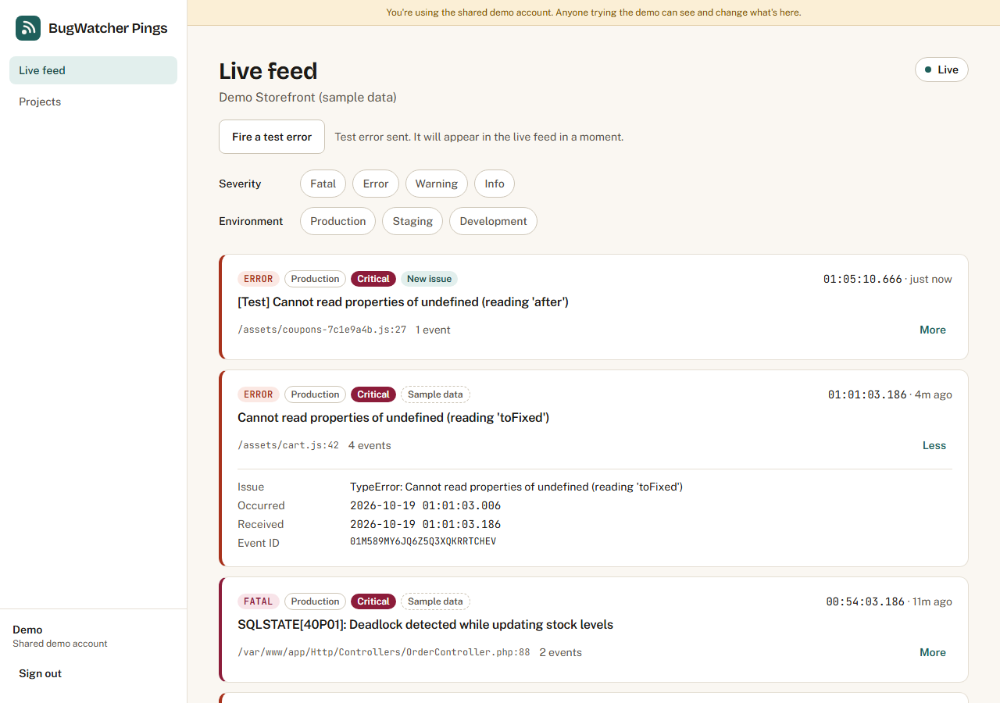
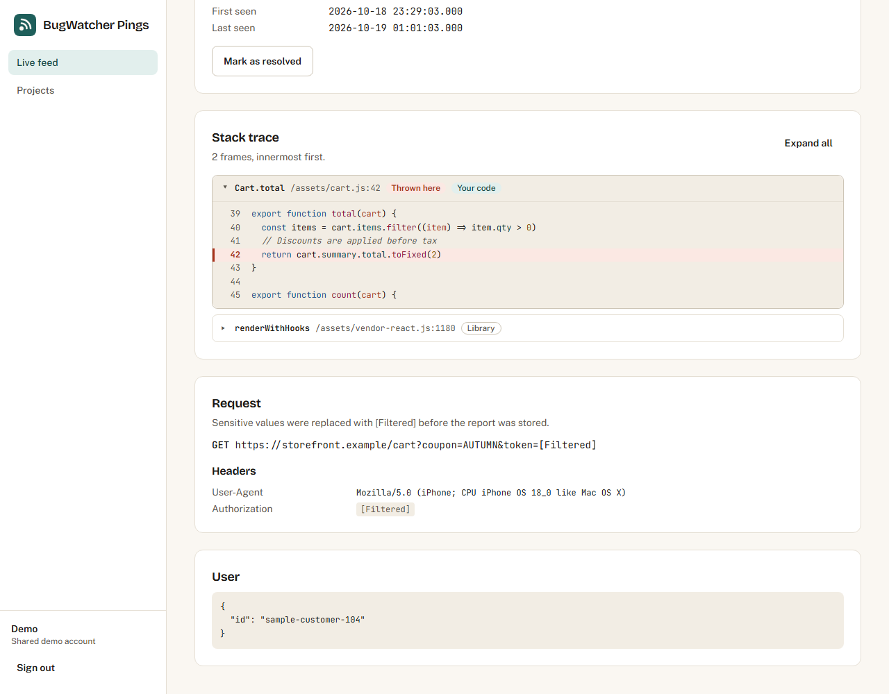
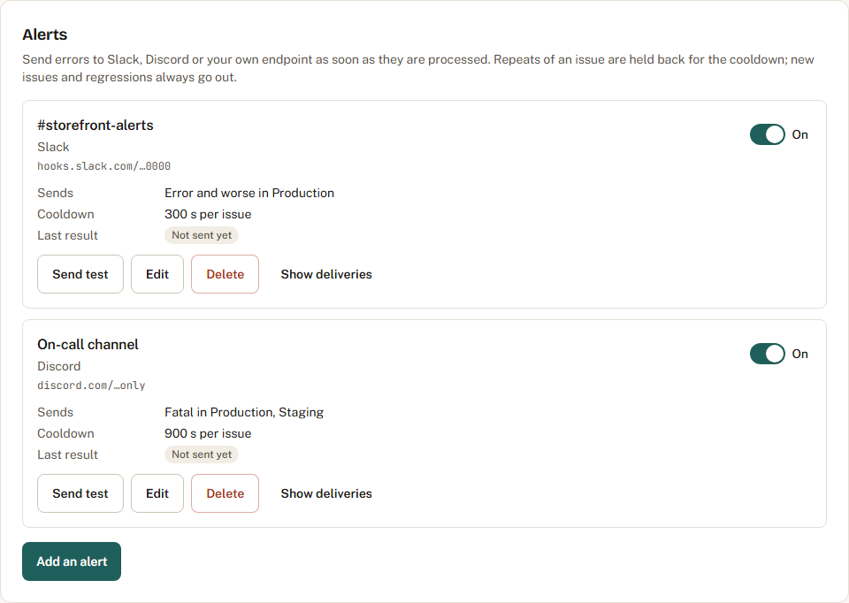
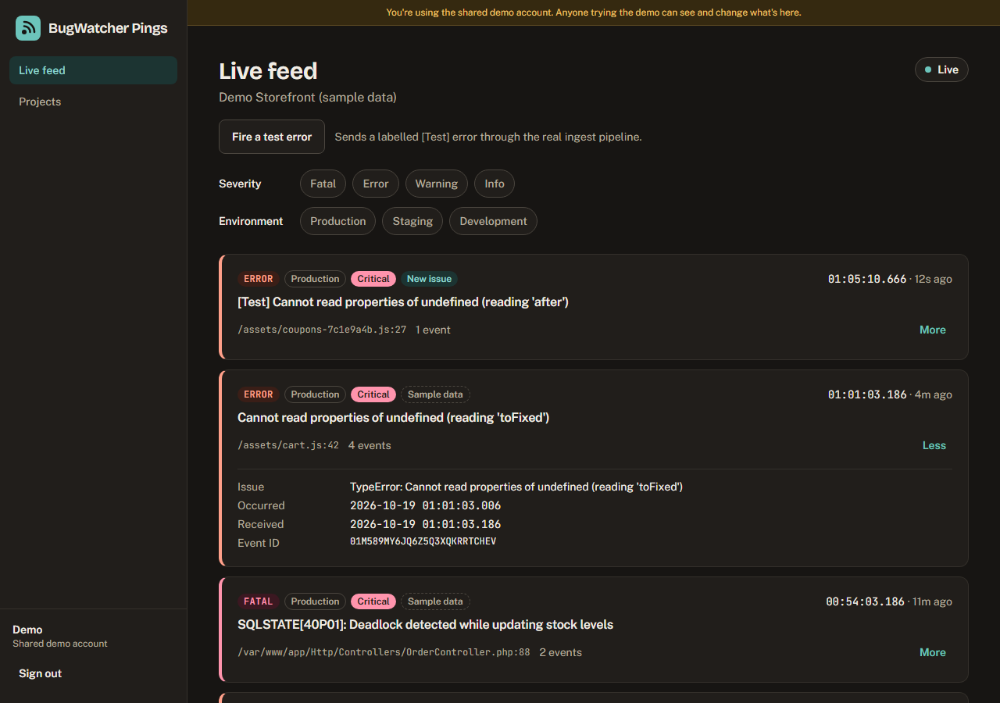
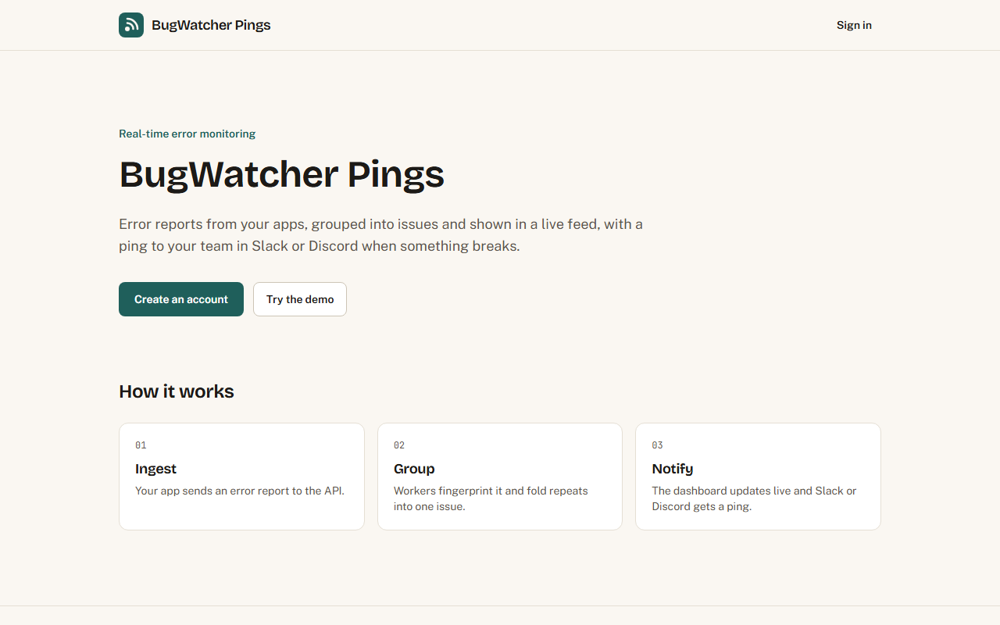

# BugWatcher Pings

BugWatcher Pings is a real-time error monitoring and alerting app. Your applications send error reports ("pings") to a Laravel API, which queues them on Redis. Workers parse each report, group repeats of the same error into one issue and store it, then broadcast it over WebSockets to a React dashboard with a live feed and send an alert to Slack or Discord.

## Live demo

| | URL | Status |
|---|---|---|
| Dashboard | https://bugwatcher-pings.vercel.app | Live, verified 19 October 2026 |
| API | https://bugwatcher-pings-api.onrender.com/api/health | Live, verified 19 October 2026 |

"Try the demo" signs into a shared account whose project holds labelled sample errors, and its "Fire a test error" button sends a real report through the ingest pipeline so you can watch it arrive live. The API runs on Render's free tier, which sleeps when idle: the first request after a quiet spell can take up to about 50 seconds.

## Screenshots

| Live feed | Event detail |
|---|---|
|  |  |
| **Alerts settings** | **Live feed, dark theme** |
|  |  |



All screenshots are of the app running locally against the seeded demo data; the test errors in them were sent with the "Fire a test error" button.

## Status

Working so far:

- Accounts: sign up (16 or older, confirmed with a checkbox; no date of birth is stored), sign in, sign out and a shared demo account, using Sanctum bearer tokens that expire after `SANCTUM_EXPIRATION` minutes
- Projects with a public SDK key (`bwp_pk_…`) and members who are either an admin or a developer
- Laravel API with JSON error responses (no stack traces when `APP_DEBUG=false`) and CORS limited to the web app's origin
- Configuration for PostgreSQL, a Redis queue (through Predis), and broadcasting through Laravel Reverb locally or Pusher in production
- Production Docker image for the API that runs migrations, switches on row level security, and runs a Redis queue worker and the web server
- React dashboard: landing page, sign in and sign up, projects list, project settings, a live error feed over WebSockets and an event detail page with the full stack trace and syntax-highlighted source
- Realtime: every processed event is broadcast to its project's private channel, authorized with a short-lived JWT; the dashboard backfills over REST after a reconnect
- Error ingestion: `POST /api/v1/ping` masks secrets and queues each report on Redis without touching the database, background workers group reports into issues by fingerprint, and reports are kept in Redis while the database is down
- JavaScript (browser) and PHP SDKs in [`sdks/`](sdks/README.md)
- Alerts: Slack, Discord and signed JSON webhooks per project, filtered by severity and environment, with a per-issue cooldown, a "Send test" button, a delivery log and server-side protection against requests to private networks (see [Alerts](#alerts))
- Demo: sample data in the demo project only, a "Fire a test error" button and a daily reset (see [The demo](#the-demo))
- Public pages: Privacy Policy, Terms of Service, Cookie Policy and FAQ, linked from the footer; per-page titles and canonical links, Open Graph and Twitter card tags, `robots.txt` and `sitemap.xml`
- Security headers on every API response, and a Content-Security-Policy for the web app (see [Security headers](#security-headers))

## Accounts, projects and roles

| Endpoint | Who | What |
|---|---|---|
| `POST /api/auth/register` | anyone | `name`, `email`, `password` (8+ characters), `age_confirmed` (must be accepted) |
| `POST /api/auth/login` | anyone | Wrong email and wrong password get the same reply |
| `POST /api/auth/demo` | anyone, when `DEMO_LOGIN_ENABLED=true` | Signs into the seeded demo account; 404 otherwise |
| `GET /api/me`, `POST /api/auth/logout` | signed in | |
| `GET /api/projects`, `POST /api/projects` | signed in | Lists the projects you belong to; creating one makes you its admin |
| `GET /api/projects/{slug}` | members | Includes the public key, which both roles need to set up the SDK |
| `PATCH /api/projects/{slug}` | admins | Rename (the slug stays the same) |
| `POST /api/projects/{slug}/rotate-key` | admins | Issues a new public key; the old one stops working |
| `GET /api/projects/{slug}/members` | members | Only admins see members' email addresses |
| `POST /api/projects/{slug}/members` | admins | `email`, `role`. Always answers 202 with the same message, whether or not the account exists |
| `PATCH`, `DELETE /api/projects/{slug}/members/{id}` | admins | Change a role or remove a member. A project always keeps at least one admin |

Authorization is handled by `ProjectPolicy`, run as route middleware before validation. Someone who isn't a member gets the same `404 Not Found.` as for a project that doesn't exist, so slugs can't be probed; a developer trying an admin action gets `403`. Member ids are scoped to the project in the URL.

Sign-in, sign-up and the demo are rate limited per IP address and (for sign-in and sign-up) per email address; over the limit the API answers `429` with a short message that the web app shows.

Run `php artisan db:seed` to create the demo account ("Demo") and its project, "Demo Storefront (sample data)", with sample errors (see [The demo](#the-demo)). The seeder is safe to run again. The demo account is shared by everyone who uses it, and the app says so while you're in it. Because of that it can't add, change or remove members or rotate keys (`403` with a short explanation), and the dashboard hides those controls for it.

## The demo

- **Sample data.** The demo project holds six sample issues with thirteen events (every severity and environment, one resolved issue, stack frames with PHP, JavaScript and TypeScript source, and request data showing `[Filtered]` values). Each sample row has `is_sample = true`, and the feed and the event page show a "Sample data" badge for it. Sample data is only ever created in the demo project (`App\Demo\DemoProject`), never in anyone else's: a new account's projects start empty.
- **Fire a test error.** `POST /api/projects/{slug}/test-error` (project admins, which includes the demo account in its own project; 5 a minute per user) builds a fixed report whose message starts with `[Test]`, runs it through the same `PingValidator`, masking and `ingest` queue as `POST /api/v1/ping`, and answers `202` with the future event id. A queue worker stores and broadcasts it, so the card arrives in the live feed over WebSockets. The report carries an `Authorization` header, a `token` query parameter and a `password` field, so the stored event shows masking at work. The dashboard shows the button above the feed for project admins.
- **Daily reset.** `php artisan demo:reset` (or `POST /api/cron/demo-reset` with the cron secret, called daily by `.github/workflows/demo-cleanup.yml`) restores the demo project's name, replaces its sample data with a fresh copy timed relative to now, deletes visitors' events older than `DEMO_EVENT_TTL_HOURS` (default 24) and any issues left without events, recounts the remaining issues, and deletes projects the demo account created. It creates the demo account and project if they are missing, so on a new deployment the first run also seeds the demo.

## Error ingestion

### `POST /api/v1/ping`

No sign-in; the project's public key identifies it, in the `X-BugWatcher-Key` header or, for `navigator.sendBeacon` (which can't set headers), as `key` in the body. The body is JSON (sent as `application/json` or `text/plain`), at most 64 KB.

```bash
curl -i -X POST http://127.0.0.1:8473/api/v1/ping \
  -H "Content-Type: application/json" \
  -H "X-BugWatcher-Key: bwp_pk_..." \
  -d '{
    "message": "Cart total is undefined",
    "level": "error",
    "environment": "production",
    "timestamp": 1760000000000,
    "release": "1.4.0",
    "exception": {
      "type": "TypeError",
      "frames": [
        {"file": "https://shop.example/assets/index-3fa9c1d2.js", "line": 42, "function": "Cart.total",
         "context_line": "return cart.total.toFixed(2);", "pre_context": ["function total(cart) {"], "post_context": ["}"]}
      ]
    },
    "request": {"method": "GET", "url": "https://shop.example/cart?token=abc", "headers": {"Authorization": "Bearer x"}},
    "user": {"id": "42"},
    "sdk": {"name": "my-sdk", "version": "1.0.0"}
  }'
```

| Field | Rules |
|---|---|
| `message` | Required string, up to 2,000 characters |
| `level` | Required: `fatal`, `error`, `warning` or `info` |
| `environment` | Required: `production`, `staging` or `development` |
| `timestamp` | Required: milliseconds since the Unix epoch, or an ISO 8601 date. Stored as the event's `occurred_at` |
| `exception.type` | Optional string |
| `exception.frames[]` | Optional, innermost frame first: `file`, `line`, `function`, `in_app`, `context_line`, `pre_context[]`, `post_context[]`. Only the first 50 frames and the 10 lines on each side of the failing line are kept |
| `request` | Optional: `method`, `url`, `headers` (object), `query` (object or string), `body` (any JSON) |
| `user.id`, `release`, `sdk.name`, `sdk.version` | Optional strings |

Other fields are dropped. Replies:

| Status | When |
|---|---|
| `202` `{"id": "<ulid>"}` | Queued. The id becomes the stored event's id |
| `401` `{"message": "Unauthorized."}` | Missing, malformed or unknown key (the same reply for all three) |
| `413` | Body over 64 KB |
| `422` `{"message", "errors": {field: [...]}}` | Not a JSON object, or a field fails the rules above |
| `429` with `Retry-After: 1` | Over `PINGS_RATE_LIMIT_PER_KEY` pings a second for the key, or `PINGS_RATE_LIMIT_PER_IP` for the client IP (default 300 each) |
| `503` with `Retry-After: 30` | Only for a key that isn't cached while the database is down |

The route answers CORS requests from any origin, without credentials, so the SDKs work from any site; the rest of the API only allows `FRONTEND_URL`. Every reply carries a `Server-Timing` header: `ingest` is the time spent in the controller and `total` the time since PHP received the request.

The route uses no session, auth guard or database: the key is looked up through the Redis cache (60 seconds for a known key, 30 for an unknown one, so a flood of bad keys can't reach the database either; rotating a key clears its entry at once), the rate limits are two Redis counters bumped in one round trip, and the masked report is pushed onto the `ingest` Redis queue as a `ProcessPing` job.

### SDKs

[`sdks/`](sdks/README.md) has two dependency-free clients, each with a runnable example:

- `sdks/js/bugwatcher.js`, an ES module for browsers: `init({ key, endpoint, environment, release })` reports uncaught errors and unhandled rejections, parses Chrome and Firefox stack traces, sends with `fetch` keepalive (falling back to `sendBeacon`), drops repeats of the same error within a second, and offers `captureException(error)`.
- `sdks/php/BugWatcher.php`, one class for any PHP app: `register()` reports uncaught exceptions and fatal errors with source context, and `captureException($e)` reports handled ones. It leaves the POST body out unless asked, times out after one second and never throws. The SDK README shows how to use it from Laravel.

### Masking

Before anything reaches Redis, the API replaces with `[Filtered]` the value of every key, at any depth, whose name contains `password`, `token` (which covers `bearer_token`, `access_token` and `refresh_token`), `secret` (covers `client_secret`), `authorization`, `cookie` (covers `set-cookie`), `api_key`, `apikey`, `x-api-key`, `credit_card`, `card_number`, `cvv` or `ssn`. Matching ignores case and separators, so `user_password`, `X-Api-Key`, `accessToken` and `Credit-Card` all match; `cvv` and `ssn` must be a whole word, so `className` is left alone. The same check is applied to the parameters in `request.url`'s query string and to a `request.query` string. The list is in `api/config/pings.php`.

### Processing, grouping and regressions

Queue workers (`php artisan queue:work redis --queue=webhooks,ingest,default`) store each report as a row in `events` and fold it into an `issues` row in one transaction. Reports with the same fingerprint share an issue. The fingerprint is a SHA-256 of the project, the exception type and the top in-app frame's file and function, without line numbers and with build hashes such as `index-3fa9c1d2.js` removed, so an error keeps its issue across deploys and when code above it moves. Without a usable frame the message is used instead, with numbers, hex values and UUIDs replaced. The issue's `event_count` and `last_seen_at` are updated with one atomic `UPDATE`; when a `resolved` issue gets a new event it is reopened and that event is flagged `is_regression`. A report delivered twice (same id) is stored once. After each commit the worker fires `App\Events\PingProcessed` with the event, the issue and the `isNewIssue` and `isRegression` flags, which is broadcast to the dashboard (see [Realtime](#realtime)) and starts any alerts (see [Alerts](#alerts)).

| Table | Columns |
|---|---|
| `issues` | `project_id`, `fingerprint`, `title`, `culprit` (file:line or function), `level`, `environment`, `status` (`open` or `resolved`), `first_seen_at`, `last_seen_at`, `event_count`. Unique per project and fingerprint |
| `events` | ULID `id`, `project_id`, `issue_id`, `level`, `environment`, `message`, `exception_type`, `file`, `line`, `stacktrace`, `request`, `user_context` (JSON), `release`, `sdk`, `is_regression`, `occurred_at`, `received_at`, `processed_at` (millisecond precision) |

### When the database is down

- A worker that can't reach the database pushes the (already masked) report onto the Redis list `bugwatcher:spool` instead of failing it. A job that fails for any other reason after 3 tries (2 and 10 seconds apart) also goes to the spool.
- `php artisan pings:drain-spool` moves spooled reports back onto the queue once the database answers; the scheduler runs it every minute and the cron endpoint runs it too. A report that has been through the spool `PINGS_MAX_SPOOL_CYCLES` times (default 10) is moved to `bugwatcher:spool:dead` for inspection instead of looping forever.
- The ingest route keeps answering 202 for keys it has seen recently: a cached key is reused for up to a day when the database can't be asked. Only a key that isn't cached at all gets 503.
- Use Redis as the cache store (`CACHE_STORE=redis`): workers check the cache between jobs, so a database cache would stop them during an outage. Redis should keep its data (AOF or RDB persistence on the host), since the queue and the spool live there until the database is back.

### Reading events and issues

All of these need a signed-in member of the project (either role); anyone else gets `404 Not Found.`, and ids from another project answer `404` too.

| Endpoint | What |
|---|---|
| `GET /api/projects/{slug}/events?before=<cursor>&limit=50` | Newest first. `limit` is 1 to 100; `level[]` and `environment[]` filter. The reply has `data` (the feed fields listed under Realtime) and `next_cursor` (`<received_at in ms>-<id>`, or `null` on the last page) |
| `GET /api/projects/{slug}/events/{id}` | One event in full: stack frames with their context lines, the request and the user context, as masked at ingestion, plus its issue. The dashboard shows it at `/app/projects/{slug}/events/{id}` |
| `GET /api/projects/{slug}/issues?status=open\|resolved&q=` | Issues by last seen, 50 a page; `q` searches titles, ignoring case |
| `PATCH /api/projects/{slug}/issues/{id}` | `status`: `open` or `resolved` |
| `POST /api/projects/{slug}/test-error` | Admins only: queues a labelled test error (see [The demo](#the-demo)). 5 a minute per user |

### Retention and the cron endpoint

`php artisan pings:prune` deletes events and webhook delivery records older than `PINGS_RETENTION_DAYS` (default 30) in batches of 5,000; it runs daily. Issues and webhook endpoints are kept.

`POST /api/cron/run` runs `pings:drain-spool` and `pings:prune` for hosts without cron, and `POST /api/cron/demo-reset` runs `demo:reset`. Both need `Authorization: Bearer <CRON_SECRET>` (compared in constant time), answer 401 otherwise or when `CRON_SECRET` is empty, and are limited to 10 calls a minute per IP.

### Measured throughput and latency

Measured on 18 October 2026 on a laptop (Intel Core i5-10210U, 4 cores and 8 threads, 8 GB RAM, Windows 11) running Docker Desktop on WSL 2. The API ran as the production image (`api/Dockerfile`: Octane on FrankenPHP, 16 PHP threads) against the `docker-compose.yml` PostgreSQL 17 and Redis 7, with the rate limits raised out of the way. Load came from `grafana/k6` (constant arrival rate, 20 seconds a step) in the same Docker network, so the load generator, the API, its queue workers, PostgreSQL and Redis all shared the same 8 virtual CPUs. Each ping was about 1 KB (two frames, request headers, a query string to mask) and all of them belonged to one issue, the worst case for the workers, since every event updates the same issue row. Latency is for 202 responses as measured by k6; `ingest` and `total` come from the `Server-Timing` header; end to end is `processed_at - occurred_at` over every event of the step (both clocks in the same Docker VM).

With 4 queue workers (`QUEUE_WORKERS=4`):

| Target rate | Achieved | Errors | Latency p50 / p95 / p99 | `ingest` p50 / p95 | `total` p50 / p95 | End to end p50 / p95 |
|---|---|---|---|---|---|---|
| 50/s | 50/s | 0 of 1,000 | 4.6 / 9.1 / 19.4 ms | 1.5 / 2.8 ms | 3.1 / 6.2 ms | 6 / 11 ms |
| 100/s | 100/s | 0 of 2,001 | 4.4 / 10.2 / 19.5 ms | 1.4 / 3.1 ms | 3.1 / 6.7 ms | 5 / 14 ms |
| 250/s | 250/s | 0 of 5,000 | 7.3 / 14.0 / 23.3 ms | 2.3 / 5.6 ms | 5.2 / 10.2 ms | 412 / 711 ms |
| 500/s | 500/s | 0 of 10,001 | 14.5 / 193 / 292 ms | 4.7 / 23.2 ms | 9.3 / 36.9 ms | 17.2 / 24.2 s |
| 1,000/s | 479/s | 0 of 11,547 (8,371 not sent) | 2.85 / 7.82 / 7.95 s | 9.2 / 47.2 ms | 16.1 / 68.0 ms | 40.1 / 50.7 s |
| 2,000/s | 385/s | 0 of 10,038 (29,977 not sent) | 6.43 / 6.96 / 7.06 s | 12.2 / 60.4 ms | 23.4 / 92.0 ms | not measured |
| 5,000/s | 286/s | 0 of 9,312 (61,158 not sent) | 4.55 / 18.2 / 18.4 s | 11.7 / 52.8 ms | 22.0 / 84.0 ms | not measured |

With no queue workers, so the API shared the CPUs only with k6, PostgreSQL and Redis: 756 pings/s achieved at a 1,000/s target and 784/s at 2,000/s, with no errors, `ingest` p50 7.7 ms and p95 25 ms.

What this shows:

- On this machine the ingest route sustains about 500 pings a second with workers running and about 780 without, with no errors at any rate. "Not sent" means k6 ran out of its 3,000 virtual users while waiting for replies: the server was saturated and queueing connections, not failing them. **The 5,000 pings/s design target was not reached here.** Reaching it needs more CPU than one laptop VM shared with the load generator; the ingest route keeps no state outside Redis, so it scales out by adding instances.
- Server time stays under 10 ms at the median up to 500/s, and rises above it once the CPUs are saturated.
- Four workers store about 175 to 220 events a second for a single hot issue (each event holds that issue's row lock for one update and the commit). Above that, reports wait on the Redis queue, which is what the end-to-end column shows. For every step up to 1,000/s, all accepted pings were stored once the queue drained; the 2,000/s and 5,000/s backlogs were discarded unprocessed to save time. More workers, or reports spread over more issues, raise this.
- Before the production image ran Octane (plain FrankenPHP, booting Laravel on every request) the same setup peaked at about 140 pings a second, with `ingest` p50 around 20 ms.

## Realtime

Each processed event is broadcast from the queue worker (`ShouldBroadcastNow`, since the worker is already off the request path) as `ping.processed` on the private channel `private-project.{slug}`. The payload is only what a feed card shows: `id`, `issue_id`, `issue_title`, `level`, `environment`, `critical` (a `fatal` or `error` in `production`), `message` (cut to 300 characters), `culprit`, `occurred_at` and `received_at` (ISO 8601 in UTC, to the millisecond), `is_new_issue`, `is_regression` and the issue's `event_count`. Request data, user context and stack frames are never broadcast. If the WebSocket server can't be reached the event is still stored and the failure is logged.

Locally the WebSocket server is Laravel Reverb (`BROADCAST_CONNECTION=reverb`, `php artisan reverb:start`); in production it is Pusher Channels (`BROADCAST_CONNECTION=pusher`, always over TLS). The dashboard uses the same code for both through `laravel-echo` and `pusher-js`, picked by `VITE_BROADCAST_DRIVER`.

Subscribing works like this:

1. The dashboard calls `POST /api/realtime/token` with its Sanctum token and gets an HS256 JWT signed with `JWT_SECRET` that expires after 5 minutes. Its claims are `sub` (the user id), `aud` (`realtime`), `iat`, `exp` and `projects` (the slugs the user belonged to when it was issued).
2. To join a channel the WebSocket client posts `socket_id` and `channel_name` to `POST /api/broadcasting/auth` with `Authorization: Bearer <JWT>`. Only the JWT is accepted there; a Sanctum token gets `401`, as does an expired, tampered or wrongly signed JWT, or one using any algorithm other than HS256. The slug must be in the token's `projects` claim and the user must still be a member in the database, otherwise `403`. The reply is the Pusher-protocol signature. The endpoint is limited to 60 requests a minute per IP.
3. The dashboard renews the JWT a minute before it expires and after every dropped connection, so resubscribing never uses a stale token.

The live feed (`/app/projects/{slug}/feed`) shows a Live, Reconnecting or Offline indicator. After a reconnect it fetches the events it missed over REST. New events go to the top straight away; if you have scrolled down, focused an older card or expanded one, the view stays where it is and a "N new events" button takes you to the top. The feed keeps at most 500 events in memory.

## Event detail page

`/app/projects/{slug}/events/{id}` shows the message, exception type, severity, environment, occurred, received and processed times to the millisecond, release, SDK, the issue (event count, first and last seen, and a Resolve or Reopen button that calls `PATCH /api/projects/{slug}/issues/{id}`), the request (method, URL, headers, query and body pretty-printed as JSON, with masked values shown as `[Filtered]`), the user context, and a "Copy as JSON" button for the whole event.

The stack trace lists every frame, innermost first. Frames from your own code (`in_app: true`) start expanded and library frames collapsed (if no frame is marked, the thrown frame is expanded); each frame header is a button, and "Expand all" toggles them all. An expanded frame shows its source lines with line numbers, the thrown line marked with a red bar and tint. Code blocks scroll sideways inside the block, never the page.

Source is highlighted with [highlight.js](https://highlightjs.org/) (core only, with the PHP, JavaScript and TypeScript grammars), loaded with a dynamic `import()` the first time a frame is shown, so it is a separate download of about 16 KB gzipped (core plus the three grammars) that no other page fetches. The language comes from the file extension (`.php`, `.js`/`.mjs`/`.cjs`/`.jsx`, `.ts`/`.tsx`); anything else is shown as plain text. highlight.js escapes the source before adding its `<span>`s, and the page only ever inserts its output; a context line containing `</code>` renders as text and creates no element (checked in the browser). The colours come from the design tokens in `web/src/index.css`; every token colour is at least 5.6:1 against the code background and the highlighted line in both themes:

| Token | Light (on `#f2ede4` / thrown line `#fbe8e3`) | Dark (on `#110f0d` / thrown line `#3a1e17`) |
|---|---|---|
| Plain text | `#1c1a17` 14.89 / 14.68 | `#f1ece4` 16.27 / 12.96 |
| Keyword, type | `#1d538c` 6.75 / 6.65 | `#90bcf2` 9.71 / 7.74 |
| String | `#1f5f5b` 6.33 / 6.24 | `#6cc4bb` 9.34 / 7.44 |
| Number, literal | `#835000` 5.79 / 5.70 | `#efc16c` 11.40 / 9.08 |
| Comment, line numbers | `#5b554d` 6.32 / 6.23 | `#b4ab9e` 8.43 / 6.72 |
| Function and class names | `#8c1c3a` 7.69 / 7.58 | `#ff94ad` 9.19 / 7.32 |
| Variable, parameter | `#a8321c` 5.74 / 5.66 | `#ffa08a` 9.70 / 7.73 |
| Attribute, property | `#164744` 8.92 / 8.79 | `#93d8d0` 11.82 / 9.41 |

## Alerts

Each project can send its errors to Slack (Incoming Webhooks), Discord (channel webhooks) or any HTTPS endpoint of your own (a signed JSON POST). Admins set them up under Project settings → Alerts.

### How an alert is sent

1. After a worker stores a ping and fires `PingProcessed`, the listener `App\Listeners\QueueWebhookAlerts` reads the project's enabled endpoints from the cache (Redis in production; the entry is cleared whenever an endpoint or the project changes, and holds no URLs or secrets).
2. An endpoint matches when the event's level is at or above its `min_level` (`info` < `warning` < `error` < `fatal`) and its environment is one of the endpoint's `environments`.
3. Repeats are limited per endpoint and issue with a Redis `SET … NX EX cooldown_seconds` (default 300; 0 turns it off). A repeat inside the window is recorded as `throttled` and not sent. A new issue or a regression is always sent and starts a new window.
4. Each send is a `SendWebhook` job on the `webhooks` queue, which workers check before `ingest` and `default`. The job checks the URL again (see below), then POSTs with the Laravel HTTP client: 2 s to connect, 5 s in total, redirects not followed, up to 3 tries 250 ms and 1 s apart for connection errors, 5xx and 429 (other 4xx and 3xx replies are not retried). Retries happen inside the one job, so an endpoint never gets the same alert twice from a retried job.
5. Every send is stored in `webhook_deliveries` with its result, the HTTP status, how long the request took and the dispatch delay: the time from `PingProcessed` being fired to the request starting. Only a generic error such as "The endpoint answered HTTP 404." is kept on the endpoint, never the response body.

If broadcasting to the dashboard fails, the alerts are still queued. Nothing in the listener can fail the job that stored the ping.

### What is sent

Every alert links to the event: `FRONTEND_URL` (the first origin, if several) + `/app/projects/{slug}/events/{id}`.

- **Slack**: Block Kit with a header (`[ERROR] TypeError: …`), the message, fields for culprit, environment, time to the millisecond (UTC), event count and project, a "New issue" or "Regression" note, and a "View in BugWatcher" button. `&`, `<` and `>` in error text are escaped, so a message containing `<!channel>` or `<https://…|text>` shows as typed instead of pinging a channel or making a link.
- **Discord**: one embed whose title links to the event, coloured by severity, with the message as the description and the same fields. `allowed_mentions` is `{"parse": []}`, so `@everyone`, `@here`, role and user mentions in error text never notify anyone.
- **Generic**: `{"type": "alert", "test": false, "project": {...}, "event": {"id", "level", "environment", "message", "exception_type", "culprit", "occurred_at", "url"}, "issue": {"id", "title", "event_count", "is_new", "is_regression"}}`, signed (below).

Text is cut to each platform's limits (Slack: 150 characters for the header, 3,000 for the message, 2,000 per field; Discord: 256 for the title, 4,096 for the description, 1,024 per field and 6,000 for the whole embed). "Send test" sends a message labelled `[TEST]` (`"type": "test"` for generic endpoints) that links to the project settings.

### Verifying a generic webhook

Each request has `X-BugWatcher-Signature: t=<unix seconds>,v1=<hex>`, where `v1` is HMAC-SHA256 over `<t>.<raw request body>` with the endpoint's signing secret (`whsec_…`, shown once when the endpoint is created). Check it against the raw body before parsing it, and reject old timestamps to stop replays:

```php
$body = file_get_contents('php://input');
parse_str(str_replace(',', '&', $_SERVER['HTTP_X_BUGWATCHER_SIGNATURE'] ?? ''), $sig);
$expected = hash_hmac('sha256', ($sig['t'] ?? '').'.'.$body, getenv('BUGWATCHER_WEBHOOK_SECRET'));

if (! isset($sig['t'], $sig['v1']) || ! hash_equals($expected, $sig['v1']) || abs(time() - (int) $sig['t']) > 300) {
    http_response_code(401);
    exit;
}
$alert = json_decode($body, true);
```

```js
import { createHmac, timingSafeEqual } from 'node:crypto'

function verify(rawBody, header, secret) {
  const { t, v1 } = Object.fromEntries(header.split(',').map((part) => part.split('=')))
  const expected = createHmac('sha256', secret).update(`${t}.${rawBody}`).digest('hex')
  return Boolean(t && v1) && v1.length === expected.length
    && timingSafeEqual(Buffer.from(v1), Buffer.from(expected)) && Math.abs(Date.now() / 1000 - Number(t)) <= 300
}
```

### Which URLs are allowed

A webhook URL makes the server send requests to wherever it points, so it is checked when an endpoint is created or changed (a `422` on `url` explains why) and again before every request:

- `https://` only, port 443 only, and no username or password in the URL (also checked on the raw text, since URL parsers disagree about `@`). Backslashes, spaces and control characters are refused.
- Slack: the host must be exactly `hooks.slack.com`. Discord: `discord.com` or `discordapp.com`, with a path starting `/api/webhooks/`.
- Generic: the host is looked up (A and AAAA) and **every** address must be public. Refused ranges: `0.0.0.0/8`, `10/8`, `100.64/10`, `127/8`, `169.254/16` (including the `169.254.169.254` metadata address), `172.16/12`, `192.0.0/24`, `192.0.2/24`, `192.88.99/24`, `192.168/16`, `198.18/15`, `198.51.100/24`, `203.0.113/24`, `224/4`, `240/4`, and for IPv6 `::`, `::1`, `::ffff:0:0/96` (IPv4-mapped), `64:ff9b::/96`, `64:ff9b:1::/48`, `100::/64`, `2001::/23`, `2001:db8::/32`, `2002::/16`, `fc00::/7`, `fe80::/10`, `fec0::/10` and `ff00::/8`. A public IPv4 or bracketed IPv6 address may be used directly; numbers in disguise such as `2130706433`, `0x7f000001`, `017700000001`, `0177.0.0.1` or `127.1` are refused, as is any host whose last label isn't alphabetic.
- The address that passed the check is pinned for the request with curl's `CURLOPT_RESOLVE`, so the name is not looked up a second time and a DNS answer that changes between the check and the request (DNS rebinding) can't point the request somewhere else. TLS still verifies the certificate for the host name. Redirects are never followed.

For local testing only, `WEBHOOKS_ALLOW_PRIVATE=true` lets generic endpoints use private and loopback addresses, `http://` and any port (Slack and Discord rules are unchanged). It is ignored when `APP_ENV=production`, so a stray setting fails closed.

### Endpoints

All need a signed-in member of the project; others get `404`, and an endpoint id from another project answers `404` too. Developers can read (URLs masked); admins can change. The shared demo account can view alerts but can't add, change, delete or test them (`403` with a short explanation), so the public demo can't be used to send requests to arbitrary URLs. The dashboard hides those controls for developers and the demo; the server enforces it either way.

| Endpoint | Who | What |
|---|---|---|
| `GET /api/projects/{slug}/webhooks` | members | Endpoints with `url_masked` (host + `/…` + the URL's last 4 characters), filters, `enabled`, `last_status`, `last_error`, `last_delivered_at`. The URL and secret are never returned |
| `POST /api/projects/{slug}/webhooks` | admins | `kind` (`slack`, `discord` or `generic`), `name`, `url`, optional `min_level` (default `error`), `environments` (default `["production"]`), `cooldown_seconds` (0 to 86,400, default 300), `enabled`. For `generic`, the reply includes `signing_secret` this one time |
| `PATCH /api/projects/{slug}/webhooks/{id}` | admins | Any of the fields above except `kind`; leave out `url` to keep the current one |
| `DELETE /api/projects/{slug}/webhooks/{id}` | admins | |
| `POST /api/projects/{slug}/webhooks/{id}/test` | admins | Sends a test message straight away (one try) and returns the delivery and a message. 5 a minute per user |
| `GET /api/projects/{slug}/webhooks/{id}/deliveries` | members | The last 50 deliveries, newest first, with `status` (`success`, `failed` or `throttled`), `http_status`, `dispatch_delay_ms` and `duration_ms` |

Creating, changing and deleting are limited to 20 a minute per user.

| Table | Columns |
|---|---|
| `webhook_endpoints` | `project_id` (deleted with the project), `kind`, `name`, `url` and `signing_secret` (both encrypted with `APP_KEY` in `text` columns), `min_level`, `environments` (JSON), `cooldown_seconds`, `enabled`, `last_status`, `last_error`, `last_delivered_at` |
| `webhook_deliveries` | `endpoint_id` (deleted with the endpoint), `event_id`, `issue_id` (`null` for tests), `status`, `http_status`, `dispatch_delay_ms`, `duration_ms`, `created_at` (indexed with `endpoint_id`) |

Both tables are covered by `php artisan db:enable-rls`, like every other table.

### Measured dispatch delay

The target is to start the request within 50 ms of the ping being processed. Measured on 19 October 2026 on the laptop described under [Measured throughput and latency](#measured-throughput-and-latency), but running natively on Windows rather than in the production image: `php artisan serve`, Reverb and two `php artisan queue:work` workers (one `webhooks,ingest,default`, one `ingest,default`, as in `start.sh`) on Windows PHP 8.4, PostgreSQL and Redis from `docker-compose.yml`, and a generic endpoint pointing at a PHP receiver on the same machine (`WEBHOOKS_ALLOW_PRIVATE=true`). 20 pings were sent one a second, each matching the endpoint with the cooldown off. All 20 requests arrived with a valid signature and a deep link to their event.

| Run | Dispatch delay p50 / p95 / max | Request duration p50 / p95 |
|---|---|---|
| First run, workers just started | 34 / 57.5 / 142 ms | 7 / 8.6 ms |
| Second run, warm | 37 / 39.2 / 43 ms | 7 / 8.1 ms |
| Warm, with broadcasting switched off | 30 / 38.5 / 104 ms (first job) | 7 / 14 ms |

With warm workers every request started within 50 ms; the first job after a worker starts took 104 to 142 ms (connections and classes loading), which is what pushes the first run's p95 over the target. Broadcasting the event to Reverb accounts for only about 5 to 7 ms of the median; most of the rest is the queue hop (the job is pushed to Redis and picked up by a worker) plus loading the endpoint and building the payload, with every database and Redis round trip crossing from Windows into Docker's VM. This was 20 pings at a low rate, one endpoint, a receiver on the same machine, and a different setup from production; it says nothing about the delay under load, when workers are busy with a backlog of pings (webhook jobs go first, but a worker finishes the job it is on), and the clocks compared are on one machine. Slack's and Discord's own latency comes on top.

## Security headers

Every response under `/api` carries `X-Content-Type-Options: nosniff`, `Referrer-Policy: no-referrer`, `X-Frame-Options: DENY` and `Content-Security-Policy: default-src 'none'; frame-ancestors 'none'`, plus `Strict-Transport-Security` over HTTPS (`App\Http\Middleware\SecurityHeaders`, registered globally so errors raised before a route runs get them too). Laravel Horizon's local dashboard is left alone.

The web app's headers are set in `web/vercel.json`. Its Content-Security-Policy is `default-src 'self'; script-src 'self'; style-src 'self'; font-src 'self'; img-src 'self'; connect-src 'self' https://bugwatcher-pings-api.onrender.com wss://*.pusher.com https://*.pusher.com; object-src 'none'; base-uri 'self'; form-action 'self'; frame-ancestors 'none'`. Fonts are self-hosted, and the build never inlines them as `data:` URLs (which `font-src 'self'` would block). This policy, with the API and Pusher origins swapped for the local API and Reverb, was applied to a `vite preview` build in Chromium while signing into the demo, receiving a live test error, opening an event (which loads highlight.js), and visiting the project settings and every public page: no violations were reported. The Pusher origins themselves are only exercised once the app runs against Pusher in production.

## Measured results

### Against the design targets

| Target | Measured | Met? |
|---|---|---|
| Ingest 5,000 pings a second | About 500 a second with workers running and 780 without, on one laptop VM shared with the load generator ([details](#measured-throughput-and-latency)) | No, not on this hardware |
| Start each alert request within 50 ms of processing | p95 39 ms with warm workers; the first job after a worker starts took 104 to 142 ms ([details](#measured-dispatch-delay)) | With warm workers |
| 99.99% availability | Not measured. The free hosting tiers sleep when idle and have no redundancy | No: it is a design target, not a guarantee (see the Terms) |

### Lighthouse and accessibility

Lighthouse 13.5 (Microsoft Edge headless, default mobile and desktop presets) against a local `vite preview` build on 19 October 2026. Scores are performance / accessibility / best practices / SEO. "Before" is the previous commit, which had no Privacy page.

| Page | Mobile before | Mobile after | Desktop before | Desktop after |
|---|---|---|---|---|
| `/` | 91 / 100 / 100 / 100 | 96 / 100 / 100 / 100 | 100 / 100 / 100 / 100 | 100 / 100 / 100 / 100 |
| `/signin` | 95 / 100 / 100 / 100 | 96 / 100 / 100 / 100 | 100 / 100 / 100 / 100 | 100 / 100 / 100 / 100 |
| `/terms` | 95 / 100 / 100 / 100 | 97 / 100 / 100 / 100 | 100 / 100 / 100 / 100 | 100 / 100 / 100 / 100 |
| `/privacy` | (new) | 96 / 100 / 100 / 100 | (new) | 100 / 100 / 100 / 100 |

Mobile performance varies by a few points between runs. What changed: the dashboard pages and the realtime client (`laravel-echo` and `pusher-js`) now load on demand, so the JavaScript a public page downloads went from 468 KB (141 KB gzipped) to 350 KB (110 KB gzipped); and the body font is preloaded, which took the Privacy page's layout shift from 0.14 (long text reflowing when the font arrived) to 0.001.

The signed-in pages were checked with axe-core (WCAG 2.0, 2.1 and 2.2 A and AA rules) through Playwright instead of Lighthouse: the live feed with a card expanded, an event page with highlighted source, project settings and the projects list, in the light and dark themes, plus every public page in both themes. No violations were found. Animations (new feed cards, spinners, skeletons, smooth scrolling) are switched off under `prefers-reduced-motion: reduce`, which an end-to-end test checks for new feed cards.

## Stack

| Part | Technology |
|---|---|
| `api/` | Laravel 13 (PHP 8.4), Laravel Sanctum, Laravel Octane on FrankenPHP (production image), PostgreSQL, Redis queue via Predis, Laravel Reverb (local) or Pusher (production) for broadcasting, Laravel Horizon for local queue monitoring |
| `web/` | React 19, Vite, Tailwind CSS 4, React Router — plain JavaScript/JSX. Playwright and axe-core for end-to-end tests |
| `sdks/` | Dependency-free JavaScript (browser) and PHP clients for the ingestion API |

## Local setup

You need PHP 8.3+ (with `pdo_pgsql`, `mbstring`, `openssl`), Composer, Docker and Node 20+. The `redis` PHP extension is not needed.

### 1. PostgreSQL and Redis

```bash
docker compose up -d
```

This starts PostgreSQL 17 on port 5432 and Redis 7 on port 6379, with data kept in named volumes. The database credentials match `api/.env.example`. `docker-compose.yml` is for local development only.

### 2. API

```bash
cd api
composer install
cp .env.example .env
php artisan key:generate
php artisan migrate
php artisan db:seed            # demo account and project
php artisan serve --port=8473
```

In separate terminals, as needed:

```bash
php artisan queue:work redis --queue=webhooks,ingest,default   # send alerts, process pings and other jobs
php artisan queue:work redis --queue=ingest,default            # optional: picks up a ping at once while the worker above waits for alerts
php artisan schedule:work                             # drains the spool every minute, prunes daily
php artisan reverb:start                              # WebSocket server on port 8080
```

Laravel Horizon is installed as a development dependency for watching the Redis queue locally (`php artisan horizon`, dashboard at `/horizon`). It needs the `pcntl` and `posix` extensions, so it does not run on Windows outside WSL or Docker. It is not used in production.

### 3. Web app

```bash
cd web
npm install
cp .env.example .env.local
npm run dev                 # http://localhost:5473
```

### Tests and checks

```bash
cd api && php artisan test && ./vendor/bin/pint --test
cd web && npm run lint && npm run build
```

### End-to-end tests

`web/e2e` has Playwright tests that run against the full local stack: the landing page and its metadata, the legal pages and footer links, `robots.txt`, `sitemap.xml` and the social image, sign-in errors, trying the demo, a test error arriving in the live feed over WebSockets (and without the entrance animation under reduced motion), expanding a card, highlighted source on the event page, no sideways scrolling at 375 px on every public and dashboard page, and axe-core checks in both themes.

```bash
docker compose up -d
cd web
npx playwright install chromium   # once
npm run test:e2e
```

The config starts `php artisan serve` on port 8473, Reverb on 8080, a queue worker and the Vite dev server, reusing any that are already running, with the settings in `api/.env` (so `DEMO_LOGIN_ENABLED=true` and a `JWT_SECRET` are needed). Before the tests it runs the migrations and `demo:reset --hours=0`, which puts the local demo project back to its sample data. The tests share the demo sign-in limit (5 a minute per IP), so leave a minute between runs. They are not part of CI, which has no Reverb or browser set up.

API tests use an in-memory SQLite database by default. To run them against PostgreSQL, set `DB_CONNECTION=pgsql` and the other `DB_*` variables in the environment, as CI does. The spool and Redis rate-limit tests need Redis on `127.0.0.1:6379` (`docker compose up -d`); they use their own key prefix.

## Environment variables

### `api/.env`

| Variable | Purpose |
|---|---|
| `APP_KEY`, `APP_URL`, `APP_ENV`, `APP_DEBUG` | Standard Laravel settings. Keep `APP_DEBUG=false` anywhere public |
| `DB_*` | Database connection. `DB_CONNECTION=pgsql` in production; `DB_SEARCH_PATH` is the schema (default `public`) and `DB_SSLMODE` is `require` for hosted databases |
| `REDIS_URL` | Full Redis connection URL (`rediss://` for TLS). Takes precedence over the host settings below |
| `REDIS_HOST`, `REDIS_PORT`, `REDIS_PASSWORD`, `REDIS_SCHEME` | Redis connection when `REDIS_URL` is empty. `REDIS_SCHEME` is `tcp` or `tls` |
| `REDIS_CLIENT` | `predis` (default) |
| `QUEUE_CONNECTION` | `redis` |
| `BROADCAST_CONNECTION` | `reverb` locally, `pusher` in production |
| `REVERB_APP_ID`, `REVERB_APP_KEY`, `REVERB_APP_SECRET`, `REVERB_HOST`, `REVERB_PORT`, `REVERB_SCHEME` | Local Reverb WebSocket server |
| `PUSHER_APP_ID`, `PUSHER_APP_KEY`, `PUSHER_APP_SECRET`, `PUSHER_APP_CLUSTER` | Pusher Channels app, when `BROADCAST_CONNECTION=pusher` |
| `FRONTEND_URL` | Origin(s) of the web app, comma-separated. Used for CORS |
| `SANCTUM_EXPIRATION` | API token lifetime in minutes (default 7 days) |
| `JWT_SECRET` | Signs the realtime JWTs (HS256). At least 32 characters; keep it secret and different per environment |
| `CRON_SECRET` | Bearer secret for `POST /api/cron/run`; empty turns the endpoint off |
| `CACHE_STORE` | `redis`. Queue workers check the cache for restart signals, so a Redis cache keeps them running (and spooling) while the database is down |
| `PINGS_CACHE_STORE` | Cache store for project key lookups and ingest rate limits (default `redis`) |
| `PINGS_KEY_CACHE_TTL`, `PINGS_KEY_CACHE_NEGATIVE_TTL` | Seconds a known key (default 60) and an unknown key (default 30) stay cached |
| `PINGS_RATE_LIMIT_PER_KEY`, `PINGS_RATE_LIMIT_PER_IP` | Pings per second per project key and per client IP (default 300 each) |
| `PINGS_QUEUE` | Queue name for pings (default `ingest`) |
| `PINGS_RETENTION_DAYS` | Events older than this are deleted by `pings:prune` (default 30) |
| `PINGS_MAX_SPOOL_CYCLES` | How many times a ping that keeps failing goes back through the spool before it is set aside (default 10) |
| `QUEUE_WORKERS` | Docker image only: queue workers started next to the web server (default 1) |
| `OCTANE_WORKERS` | Docker image only: Octane HTTP workers (default 2) |
| `DEMO_LOGIN_ENABLED` | `true` turns on `POST /api/auth/demo` (default `false`). Needs the demo account from `php artisan db:seed` or `demo:reset` |
| `DEMO_EVENT_TTL_HOURS` | `demo:reset` keeps visitors' events in the demo project for this many hours (default 24) |
| `PINGS_REDIS_CONNECTION` | Redis connection (from `config/database.php`) for the spool and alert cooldowns (default `default`) |
| `PORT` | Docker image only: the port the web server listens on (default 8080; Render sets it) |
| `WEBHOOKS_ALLOW_PRIVATE` | Local testing only: `true` lets generic webhooks reach private and loopback addresses over `http://` on any port (default `false`). Ignored when `APP_ENV=production` |
| `REDIS_QUEUE_BLOCK_FOR` | Seconds an idle worker waits on its first queue before checking the others (default 5) |

### `web/.env.local`

| Variable | Purpose |
|---|---|
| `VITE_API_URL` | Base URL of the API, including `/api` |
| `VITE_BROADCAST_DRIVER` | `reverb` locally, `pusher` in production |
| `VITE_REVERB_APP_KEY`, `VITE_REVERB_HOST`, `VITE_REVERB_PORT`, `VITE_REVERB_SCHEME` | Local Reverb server; the key is `REVERB_APP_KEY` from the API's `.env` |
| `VITE_PUSHER_KEY`, `VITE_PUSHER_CLUSTER` | Pusher Channels app key and cluster (the key is public) |

## Deploying

This is how the live demo is deployed. Use separate secrets per environment and never commit them.

1. **Database (Supabase PostgreSQL).** Create a project, then a dedicated schema and login role for the app, as described under [Row level security](#row-level-security). Use the session pooler's host and port (IPv4) with `DB_SSLMODE=require`, `DB_SEARCH_PATH=<schema>` and the role's credentials. Migrations run when the API starts.
2. **Redis (Upstash).** Create a Redis database and set `REDIS_URL` to its `rediss://default:<password>@<host>:6379` URL (TLS). Keep `CACHE_STORE=redis`, `QUEUE_CONNECTION=redis` and `PINGS_CACHE_STORE=redis`. Upstash only has database 0, so also set `REDIS_CACHE_DB=0` (the cache otherwise uses database 1).
3. **Realtime (Pusher Channels).** Create a Channels app. On the API set `BROADCAST_CONNECTION=pusher`, `PUSHER_APP_ID`, `PUSHER_APP_KEY`, `PUSHER_APP_SECRET` and `PUSHER_APP_CLUSTER`; on the web app set `VITE_BROADCAST_DRIVER=pusher`, `VITE_PUSHER_KEY` and `VITE_PUSHER_CLUSTER`. Only the key and cluster are public.
4. **API (Render).** A Docker web service with root directory `api` and health check path `/api/health`. Set `APP_KEY` (from `php artisan key:generate --show`), `APP_URL`, the `DB_*` and Redis variables above, the Pusher variables, `JWT_SECRET` (32 or more random characters), `CRON_SECRET`, `FRONTEND_URL=https://bugwatcher-pings.vercel.app` and `DEMO_LOGIN_ENABLED=true`.
5. **Web app (Vercel).** Import the repository with root directory `web` (Vite preset) and set `VITE_API_URL=https://bugwatcher-pings-api.onrender.com/api` plus the Pusher variables. `web/vercel.json` adds the security headers and sends unknown paths to `index.html`; Vercel serves real files (`robots.txt`, `sitemap.xml`, `og-image.png`, `assets/`) before it applies that rewrite.
6. **Scheduled jobs (GitHub Actions).** Set the repository variable `API_URL` (`https://bugwatcher-pings-api.onrender.com`) and the secret `CRON_SECRET`. `cron.yml` then drains the spool and prunes every 15 minutes, and `demo-cleanup.yml` resets the demo daily. Run "Demo cleanup" once by hand after the first deploy to create the demo account and its sample data.

Then check that both URLs answer (the first API request may take a minute while the service wakes), try the demo, fire a test error, and update the [Live demo](#live-demo) table.

### The API image

`api/Dockerfile` builds a production image (FrankenPHP, PHP 8.4, OPcache, `pdo_pgsql`, `pcntl`) that listens on `$PORT` (default 8080). It sets `APP_ENV=production`, `APP_DEBUG=false` and logs to stderr; it contains no secrets, so set `APP_KEY`, the `DB_*` and Redis variables, the `PUSHER_*` variables (with `BROADCAST_CONNECTION=pusher`), `JWT_SECRET` and `FRONTEND_URL` in the host's environment. On every start, `api/docker/start.sh` caches config, routes and views, runs `php artisan migrate --force`, switches on row level security (`php artisan db:enable-rls`, see below), starts `QUEUE_WORKERS` Redis queue workers (queues `webhooks,ingest,default`) plus one more on `ingest,default`, and the scheduler, in the background (each restarted if it exits) and then the web server: Laravel Octane on FrankenPHP in worker mode with `OCTANE_WORKERS` workers (default 2), which keeps the app booted between requests. Horizon and Reverb are not run in production.

Render's free tier has no cron and sleeps when idle, so `.github/workflows/cron.yml` calls `POST /api/cron/run` every 15 minutes. Set the repository variable `API_URL` and the secret `CRON_SECRET` (the same value as the API's `CRON_SECRET`) to switch it on.

The intended host is a Render Docker web service (root directory `api`, health check `GET /api/health`) at `https://bugwatcher-pings-api.onrender.com`, with a hosted PostgreSQL database and a hosted Redis.

### Row level security

The API reaches PostgreSQL through its own role, which owns the app's schema and tables. `php artisan db:enable-rls` (a no-op on other databases) switches on row level security for every table in the schema and adds one explicit policy to each, `deny_non_owner_roles`: a restrictive policy for all commands and all roles with `USING (false) WITH CHECK (false)`. RLS is not forced, so the owning app role is unaffected, while any other role, such as a hosted provider's API roles, is denied every row even if it is later granted access to a table. Because the policy is restrictive, the denial still holds if a permissive policy is added later. The command is safe to run repeatedly and runs after every migration in `start.sh`, so new tables are covered.

For PostgreSQL in a dedicated schema of a shared database (for example a Supabase project), give the app its own login role that owns the schema, with no access granted to other roles, and set `DB_SEARCH_PATH` to that schema.

### The web app

`web/vercel.json` sets a Content-Security-Policy whose `connect-src` allows `'self'`, the API origin (`https://bugwatcher-pings-api.onrender.com`) and Pusher's WebSocket and HTTP endpoints (see [Security headers](#security-headers)). If the API moves, update that origin, or the app cannot reach the API. The canonical, Open Graph and sitemap URLs in `web/index.html`, `web/public/robots.txt`, `web/public/sitemap.xml` and `web/src/hooks/useDocumentTitle.js` use `https://bugwatcher-pings.vercel.app`; change them together if the site moves.

## Security

See [SECURITY.md](SECURITY.md) to report a vulnerability.

## Privacy and terms

The web app has a [Privacy Policy](https://bugwatcher-pings.vercel.app/privacy), [Terms of Service](https://bugwatcher-pings.vercel.app/terms), [Cookie Policy](https://bugwatcher-pings.vercel.app/cookies) and [FAQ](https://bugwatcher-pings.vercel.app/faq) (sources in `web/src/pages/public/`). They describe the hosted service as set up above; if you run your own copy with other providers or retention settings, update them.

## License

Free for personal, educational and other noncommercial use under the [PolyForm Noncommercial License 1.0.0](LICENSE).

## Commercial use

Using BugWatcher Pings for commercial purposes, including running it as a service for paying customers or inside a business, requires a paid commercial license. Contact Fazal Abbas at fazalabbas2002@gmail.com with a short description of how you plan to use it.

© 2026 Fazal Abbas
